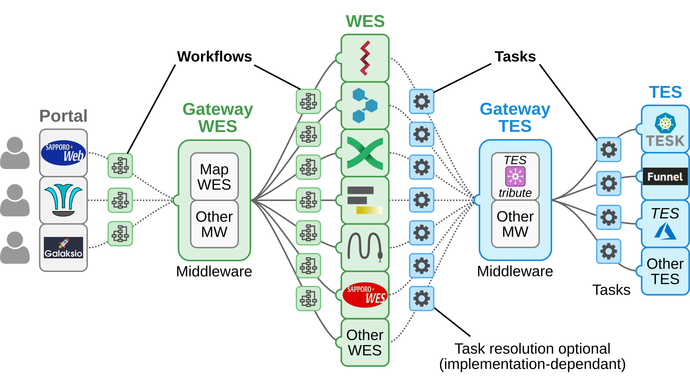

# proWES

--8<-- "README.md:synopsis"

## Contents

- [Getting started](getting-started.md): run proWES with Docker Compose and
  send the first requests.
- [Configuration](configuration.md): the app configuration, environment
  variables, overlays, the server and the service info.
- [API](api.md): the endpoints, how runs are forwarded, and errors.
- [Access control](access-control.md): authentication and run ownership.
- [Deployment](deployment.md): the Helm chart for Kubernetes.
- [Operations](operations.md): the components, the image, secrets, logs and
  the tracking of runs.
- [Upgrading](upgrading.md): changes to existing deployments and data.
- [Development](development.md): development setup, checks, CI, dependency
  updates and the documentation.
- [Contributing](contributing/index.md): how to contribute, citation metadata
  and the Python guidelines.
- [API reference](reference.md): the code, generated from its docstrings.
- [Changelog](changelog.md): release notes.

## Architecture

proWES provides central features to a federated network of independently
operated WES instances: it can serve, for example, as a compatibility layer,
a load balancer, a public entry point to an enclave of independent compute
nodes, or a means of collecting telemetry.

proWES is a [Flask](https://flask.palletsprojects.com/) app built with
[FOCA](https://github.com/elixir-cloud-aai/foca), configured declaratively in
YAML. It stores incoming and forwarded runs in a
[MongoDB](https://www.mongodb.com/) database. Forwarded runs are tracked
asynchronously by [Celery](https://docs.celeryq.dev/) workers, which can be
scaled up, via a [RabbitMQ](https://www.rabbitmq.com/) broker. A
[Helm](https://helm.sh/) chart and a [Docker
Compose](https://docs.docker.com/compose/) setup are provided for
deployments on Kubernetes and for development, respectively.

!!! note "Work in progress"
    proWES is being aligned with
    [proTES](https://protes.readthedocs.io/), the gateway for the GA4GH Task
    Execution Service: authentication of clients and WES instances, FOCA's
    gateway plugins for routing and processing runs, and WES 1.1.0. Until
    then, runs are forwarded to the first of the configured WES instances
    (see [WES instances](configuration.md#wes-instances)).

## Citation

--8<-- "README.md:citation"

## License

This project is covered by the [Apache License
2.0](https://www.apache.org/licenses/LICENSE-2.0) also [shipped with this
repository](https://github.com/elixir-cloud-aai/prowes/blob/dev/LICENSE).

## Contact

The project is a collaborative effort under the umbrella of [ELIXIR
On-Cloud](https://elixir-on.cloud/). Follow the link to get in touch with us
via chat or email. Please mention the name of this service for any inquiry,
proposal, question etc. Report bugs and request features in the [issue
tracker](https://github.com/elixir-cloud-aai/prowes/issues).
